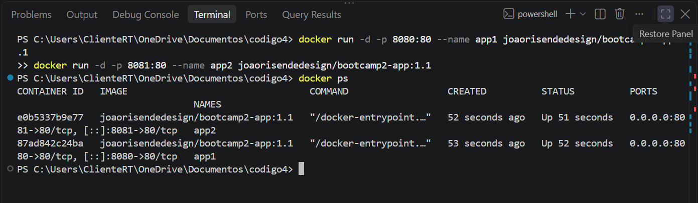

# Pokédex

## Autor
joão Humberto Resende do Nascimento — Matrícula 22606172

## Descrição
Aplicação web para pesquisar qualquer Pokémon por nome ou número e consultar seus dados, sua linha de evolução (incluindo Mega Evoluções e outras formas especiais) e curiosidades da Pokédex. Útil para fãs e jogadores que querem consultar informações rápidas.

## API utilizada
- **PokeAPI** — https://pokeapi.co/docs/v2
- Endpoints consumidos:
  - `GET /pokemon/{nome ou id}` — dados básicos, imagens, tipos, atributos
  - `GET /pokemon-species/{id}` — curiosidades, categoria, habitat, formas (megas)
  - `GET /evolution-chain/{id}` — linha evolutiva
  - `GET /pokemon?limit=1025` — lista de nomes para o autocompletar

## Funcionalidades
- Buscar um Pokémon por nome ou número, com autocompletar
- Sortear um Pokémon aleatório e navegar para o anterior/próximo
- Aba **Visão geral**: altura, peso, habilidades e atributos em barras animadas
- Aba **Evoluções e Megas**: linha evolutiva (com condição de evolução) e formas Mega, Primal e Gigantamax; clique em qualquer uma para abri-la
- Aba **Curiosidades**: textos da Pokédex de vários jogos (com botão "Outra curiosidade"), habitat, geração, taxa de captura e mais
- Ver a versão brilhante (shiny) e ouvir o grito do Pokémon
- Histórico de pesquisas recentes e links compartilháveis (ex.: `#pikachu`)
- Mensagens amigáveis para busca sem resultado ou API fora do ar

## Como executar localmente
1. Clone: `git clone https://github.com/joaorisende-design/bootcamp2-app.git`
2. Abra o arquivo `index.html` no navegador

## Links
- **Aplicação no ar (GitHub Pages):** https://joaorisende-design.github.io/bootcamp2-app/
- **Repositório:** https://github.com/joaorisende-design/bootcamp2-app

## Segunda Entrega!


# Pokédex

## Autor
joão Humberto Resende do Nascimento — Matrícula 22606172

## Descrição
Pokédex web que consulta a PokeAPI e mostra dados de cada Pokémon (estatísticas, evoluções, curiosidades). O usuário pode montar o seu time de Pokémon, que fica salvo em um banco de dados.

## API utilizada
- **PokeAPI:** https://pokeapi.co/docs/v2
- Endpoints consumidos:
  - `https://pokeapi.co/api/v2/pokemon/{nome ou id}`
  - `https://pokeapi.co/api/v2/pokemon-species/{nome ou id}`
  - `https://pokeapi.co/api/v2/evolution-chain/{id}`
  - `https://pokeapi.co/api/v2/pokemon?limit=1025` (lista de nomes para o autocompletar)

## Funcionalidades
- Buscar um Pokémon por nome ou número, ou sortear um aleatório
- Ver altura, peso, habilidades, tipos e estatísticas com barras
- Ver a linha evolutiva e as formas especiais (Mega, Primal, Gigantamax)
- Ler curiosidades da Pokédex, ouvir o grito e ver a versão brilhante
- Histórico de pesquisas recentes
- Mensagens amigáveis para busca sem resultado ou API fora do ar
- **Meu time:** adicionar e remover Pokémon de um time salvo em banco de dados

## Links
- **Repositório GitHub:** https://github.com/joaorisende-design/bootcamp2-app
- **Aplicação no ar (GitHub Pages):** https://joaorisende-design.github.io/bootcamp2-app/
- **Imagem no Docker Hub:** https://hub.docker.com/r/joaorisendedesign/bootcamp2-app

## Como executar

### Com Docker (recomendado)
```
docker run -d -p 8080:80 joaorisendedesign/bootcamp2-app:1.0
```
Depois acesse http://localhost:8080

### Localmente, sem Docker
1. Clone: `git clone https://github.com/joaorisende-design/bootcamp2-app.git`
2. Abra a pasta no VS Code e rode com a extensão Live Server (o código usa módulos JavaScript, então não funciona abrindo o `index.html` com duplo clique).

## Persistência de dados
- **Banco escolhido:** Supabase (PostgreSQL), acessado direto do frontend pela biblioteca `supabase-js`.
- **Tabela `favoritos`:**

| Coluna | Tipo | Descrição |
|---|---|---|
| `id` | bigint (identity, chave primária) | identificador do registro |
| `criado_em` | timestamptz (padrão `now()`) | data e hora em que foi adicionado |
| `nome_item` | text | nome do Pokémon (ex.: `pikachu`) |
| `dados_extra` | text | número do Pokémon, usado para mostrar a imagem |

- **O que é salvo:** o time de Pokémon montado pelo usuário.
- **Operações:** criar (botão "Adicionar ao time"), listar (seção "Meu time", carregada ao abrir a página) e excluir (botão "Remover do time" no cartão ou o ✕ na seção do time).
- Os dados continuam salvos depois de fechar o navegador.
- **Limitação conhecida:** as políticas de acesso (RLS) estão abertas para o papel `anon`, ou seja, qualquer visitante pode ler, criar e excluir registros. Não há login de usuários, então o time é compartilhado por todos que abrem a aplicação.

## Docker
A aplicação é servida por um Nginx dentro do container. O `Dockerfile` usa a imagem `nginx:alpine` e copia `index.html`, `style.css` e `script.js` para a pasta servida pelo Nginx.

## Sidequests

### SQ1 — .dockerignore
O arquivo `.dockerignore` exclui `.git`, `README.md`, `prints` e os arquivos `*.md` da imagem. Isso deixa a imagem menor, porque arquivos que não fazem parte da aplicação não são copiados, e o build fica mais rápido, porque o Docker envia menos arquivos para o contexto de build.

### SQ2 — Versionamento de imagem
Tags publicadas no Docker Hub:
- `1.0`: primeira versão funcional
- `1.1`: versão com melhorias nos textos da interface
- `latest`: aponta para a versão mais recente

### SQ3 — Descrição no Docker Hub
O Overview do repositório no Docker Hub descreve a aplicação, traz o comando `docker run` pronto e o link do repositório no GitHub.

### SQ4 — Explorando a orquestração
Dois containers da mesma imagem rodando ao mesmo tempo, nas portas 8080 e 8081:



**Se eu tivesse 100 containers, como gerenciaria?**

Subir dois containers com `docker run` é simples, mas 100 containers à mão seria inviável: eu teria que iniciar cada um, escolher portas sem conflito, reiniciar os que falham e distribuir o trabalho entre vários servidores. Para isso existe o **Kubernetes**, um orquestrador de containers. Ele funciona com um **cluster**, que é um conjunto de máquinas (chamadas nós) gerenciadas como se fossem um só computador. Nele, a menor unidade é o **pod**, que agrupa um ou mais containers que rodam juntos. Em vez de iniciar containers um a um, eu descrevo o estado desejado, por exemplo "quero 100 réplicas da minha aplicação", e o Kubernetes cria e mantém essas **réplicas** (cópias idênticas do mesmo pod) espalhadas pelos nós. Se um pod ou um nó falha, ele recria o pod automaticamente. Ele também distribui o tráfego entre as réplicas, permite aumentar ou diminuir a quantidade de cópias conforme a demanda e atualiza para uma nova versão da imagem aos poucos, sem derrubar a aplicação.